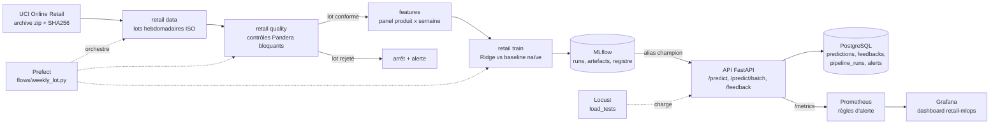

# retail-mlops : prévision des ventes hebdomadaires par produit

Chaîne MLOps locale pour un cas de réassort : prévoir, pour chacun des 50 produits
les plus vendus d'un e-commerce britannique, la quantité vendue la semaine suivante.

Les données viennent d'[UCI Online Retail](https://archive.ics.uci.edu/dataset/352/online+retail)
(CC BY 4.0), rejouées par lots ISO. Le modèle (Ridge contre une baseline naïve) reste
simple : on évalue surtout la chaîne données, qualité, entraînement, registre, API,
supervision et charge.

Détails : [docs/DATA.md](docs/DATA.md), [docs/PLAN.md](docs/PLAN.md),
[docs/SYNTHESE_OPS.md](docs/SYNTHESE_OPS.md).
Le code est sous [licence MIT](LICENSE). Les données UCI restent en CC BY 4.0.

## Architecture



Chaque semaine rejouée suit la même chaîne. Le lot est extrait de l'archive UCI, puis contrôlé avant tout prétraitement. Un lot non conforme interrompt la chaîne et déclenche une alerte, sans aucun entraînement.

Un lot conforme alimente le panel de variables, puis l'entraînement. Chaque run est tracé dans MLflow avec ses données, ses paramètres, ses métriques et ses artefacts. Le nouveau modèle est enregistré comme challenger et ne devient champion que si sa MAE est au plus égale à celle du champion sur le même jeu de test. Le tag `previous_champion` permet le retour arrière.

L'API sert toujours la version champion et renvoie son numéro dans chaque réponse. Les prédictions, leurs durées, les erreurs et les feedbacks sont conservés dans PostgreSQL. Prometheus collecte les métriques de l'API, et Grafana les affiche avec le suivi des traitements.

Prefect enchaîne les étapes à intervalle régulier, relance les échecs techniques et signale les échecs. Locust mesure la capacité de l'API selon plusieurs configurations de ressources.

| Composant | Rôle | Emplacement |
|---|---|---|
| Ingestion | téléchargement, vérification SHA256, découpage en lots | `src/retail/data/` |
| Qualité | schémas Pandera, nettoyage, rapport bloquant | `src/retail/quality/` |
| Variables | panel produit par semaine | `src/retail/features/` |
| Entraînement | Ridge et baseline, métriques | `src/retail/training/` |
| Registre | promotion champion et challenger, retour arrière | `src/retail/registry/` |
| Orchestration | rejeu des lots, verrou, flow Prefect | `src/retail/orchestration/`, `flows/` |
| API | prédictions en ligne et par lot, feedbacks, alertes | `src/retail/api/` |
| Persistance | tables SQLAlchemy | `src/retail/db/` |
| Supervision | Prometheus, règles d'alerte, Grafana | `monitoring/` |
| Charge | scénarios et campagnes Locust | `load_tests/` |
| Configuration | fichiers YAML et `.env` | `configs/`, `.env.example` |

Les services PostgreSQL 16, MLflow 2.22.2, Prometheus 2.55.1 et Grafana 11.4.0 tournent avec `docker-compose.yml`. Le serveur Prefect et l'API tournent en local pendant la démo.

## Prérequis

Python 3.11 à 3.13, Git, Docker. Sous Windows, activer `.venv\Scripts\Activate.ps1`.

## Installation

```bash
python -m venv .venv
pip install -r requirements.lock
pip install -e . --no-deps
cp .env.example .env
```

Sous PowerShell : `copy .env.example .env`.

`RETAIL_MLFLOW_TRACKING_URI=http://127.0.0.1:5001` dans `.env` aligne train, API et
Prefect sur le même registre Docker. L'image MLflow du compose est `v2.22.2`
(le tag `v2.22.5` n'existe pas sur GHCR).

```bash
retail check-config
docker compose up -d postgres mlflow prometheus grafana
retail db-init
```

L'archive UCI n'est pas dans Git. `retail data` la télécharge, vérifie le SHA256 de
`configs/data.yaml` et découpe les lots. Si UCI est injoignable, déposer
`online_retail.zip` dans `data/raw/` puis relancer.

## Démarrer, pipeline, démo

Arrêter d'abord un éventuel conteneur `api` (profil `load`) qui occupe aussi le port 8001 :

```bash
docker compose --profile load stop api
retail data
retail quality
retail train --until-week 2011-W38
retail train --until-week 2011-W40
```

Dans un autre terminal : `retail api` (port 8001).

```bash
retail demo --reset-cursor
```

`--reset-cursor` remet le curseur sur 2011-W40 (une fois avant la soutenance).
La démo a besoin de l'API hôte, de Postgres, et de deux versions MLflow.
Arrêter Locust avant de la lancer.

Sans Prefect : `retail replay`. Avec Prefect, deux terminaux, en IPv4
(`127.0.0.1`, pas `localhost`) :

```bash
prefect server start --host 127.0.0.1 --port 4201
```

```bash
$env:PREFECT_API_URL = "http://127.0.0.1:4201/api"
python flows/weekly_lot.py
```

Charge (arrêter l'API hôte ; `run.py` démarre l'API Docker) :

```bash
python load_tests/run.py --smoke --only 1w_0p5cpu
python load_tests/run.py
```

Les cibles `make` appellent `python -m retail` (ex. `make train UNTIL_WEEK=2011-W40`,
`make demo RESET=1`, `make stack`). Sous Windows, la CLI `retail` suffit.

## Adresses

| Service | URL |
|---|---|
| API | http://127.0.0.1:8001 (`/docs`, `/health`, `/metrics`) |
| MLflow | http://127.0.0.1:5001 |
| Grafana | http://127.0.0.1:3001 (admin / mot de passe de `.env`) |
| Prometheus | http://127.0.0.1:9091 |
| Prefect | http://127.0.0.1:4201 |
| Postgres | `127.0.0.1:5437` |

Ports définis dans `.env.example`.

## Vérification

```bash
retail check-config
ruff check .
ruff format --check .
pytest
```

CI GitHub : ruff, `retail check-config`, pytest (Python 3.11, 3.12, 3.13).

## Documentation

- [docs/DATA.md](docs/DATA.md) : source UCI, licence, rejeu hebdomadaire
- [docs/PLAN.md](docs/PLAN.md) : phases du mini-projet
- [docs/SYNTHESE_OPS.md](docs/SYNTHESE_OPS.md) : charge, incidents, limites
- [docs/captures/README.md](docs/captures/README.md) : captures jury
- [monitoring/README.md](monitoring/README.md), [load_tests/README.md](load_tests/README.md),
  [flows/README.md](flows/README.md), [docker/README.md](docker/README.md)
